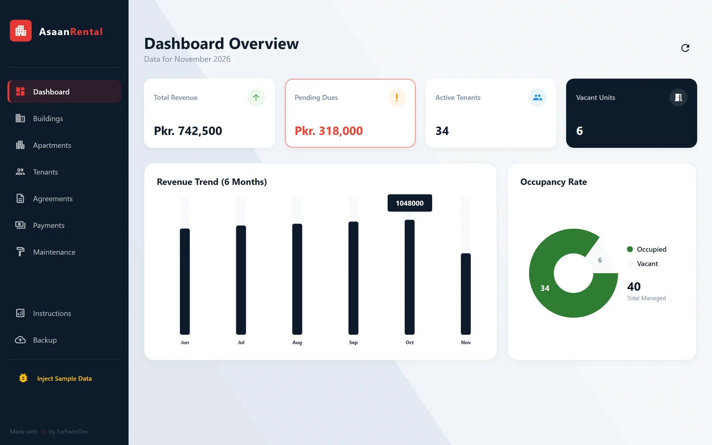
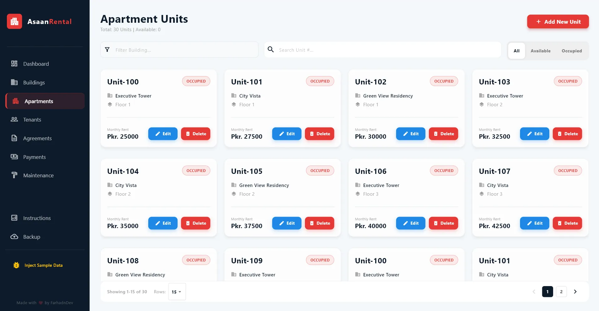
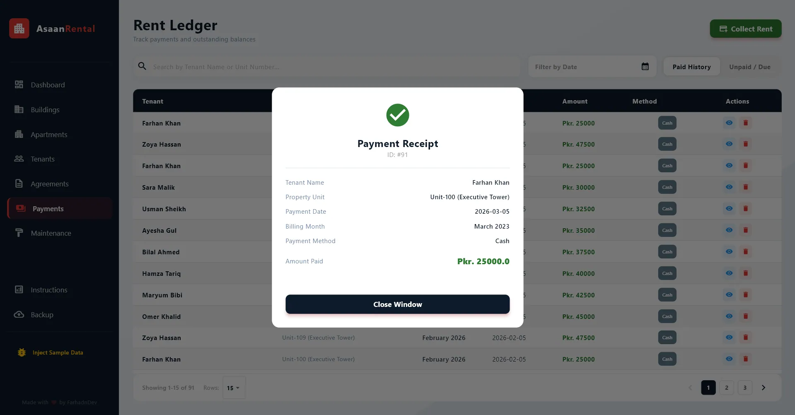
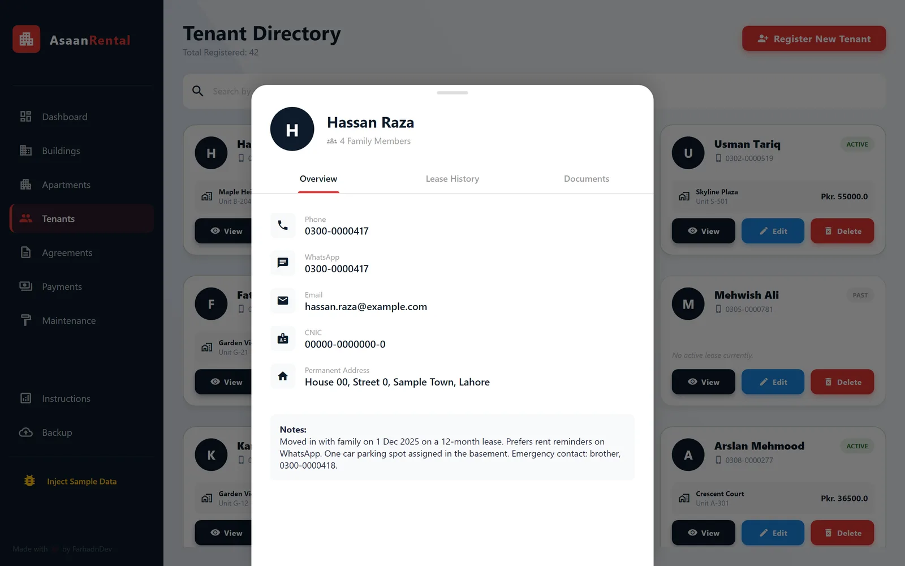
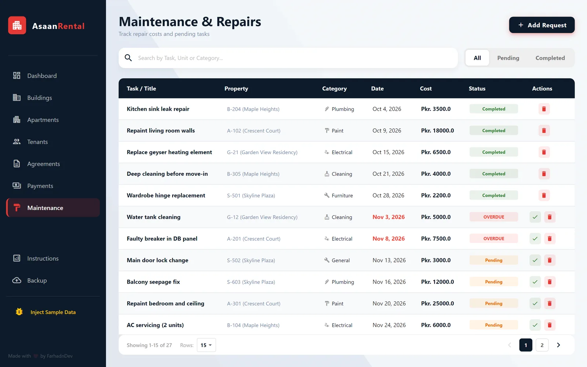

<h1 align="center">Asaan Rental Pro</h1>

  <strong>An offline Windows desktop app for landlords to manage buildings, tenants, leases, monthly rent and maintenance in one place.</strong>

  
  
  

  
   
  The dashboard: this month's revenue, pending dues, active tenants and vacant units, with a six-month revenue trend and occupancy chart. Recreated from the app's source code with demo data.

---

## About

Asaan Rental Pro is a Windows desktop application for property owners and managers who rent out apartments across one or more buildings. It keeps buildings, units, tenants, lease agreements, monthly rent payments and maintenance jobs together in a single app that runs entirely on your own computer.

The workflow follows the way a rental business works: add a building, add its units, register tenants, then create an agreement that links a tenant to a unit. From then on, rent is recorded month by month against the agreement, and the app works out who is still due.

All data is stored locally, so the app works without an internet connection and you keep ownership of your records. Backups can go to any folder on your PC or to your own Google Drive.

It is built for small and medium landlords, property owners and real estate offices that manage several buildings and units.

## Key features

**Properties and tenants**
- **Monthly dashboard:** current-month revenue, pending dues, active tenants and vacant units, plus a six-month revenue chart and an occupancy chart.
- **Buildings and units:** buildings with address and notes; units with floor, monthly rent and status. Filter units by building, search by unit number, or show only Available or Occupied units.
- **Tenant directory:** phone and WhatsApp numbers, CNIC number, email, family size, address, a profile photo and front and back ID card images.
- **Lease agreements:** each agreement links a tenant to a unit with start and end dates, monthly rent, security deposit, notes and an attached document. Creating or ending an agreement updates the unit's occupancy automatically.

**Rent and maintenance**
- **Rent ledger:** record payments per billing month with a payment method and a proof image. The Paid History view has date filters and an on-screen receipt; the Unpaid / Due view lists every active agreement without a payment for the selected month.
- **WhatsApp reminders:** one click opens WhatsApp with a pre-filled reminder that includes the pending month and amount.
- **Maintenance tracking:** jobs per apartment with category, cost, scheduled date and status, with search and pagination.

**Security and backup**
- **PIN lock:** a 4-digit PIN is set on first run and required every time the app opens. It is stored as a SHA-256 hash, never as plain text.
- **Local backup:** export the whole data folder (database and images) to any location on your PC.
- **Google Drive backup:** sign in with Google to upload a backup to a dedicated folder in your own Drive. Once you are signed in, an automatic backup runs every hour while the app is open.
- **Built-in guide and demo data:** an instructions screen walks new users through the Buildings, Apartments, Tenants, Agreements and Payments flow, and a sample data option fills the app for a quick tour.

## Screenshots

<table>
  <tr>
    <td width="50%" align="center"> <b>Apartment units</b> with status, building, floor and rent <i>Real screenshot</i></td>
    <td width="50%" align="center"> <b>Rent ledger</b> with an on-screen payment receipt <i>Real screenshot</i></td>
  </tr>
  <tr>
    <td width="50%" align="center"> <b>Tenant profile</b> with contact details, lease history and documents <i>Recreated from the app's source code with demo data</i></td>
    <td width="50%" align="center"> <b>Maintenance and repairs</b> with overdue jobs flagged <i>Recreated from the app's source code with demo data</i></td>
  </tr>
</table>

## Download and install

The current release is **[v1.0.0](https://github.com/farhadnazir/Asaan_rental_app/releases/tag/v1.0.0)** (8 March 2026).

**System requirements**
- Windows 10 or Windows 11, 64-bit
- About 12 MB for the installer download
- An internet connection only for Google Drive backup and WhatsApp reminders; everything else works offline

**Install**
1. Open the [v1.0.0 release](https://github.com/farhadnazir/Asaan_rental_app/releases/tag/v1.0.0) and download `Asaan_RentalPro_Setup.exe`.
2. Run the installer. It installs for the current Windows user and can add a desktop shortcut.
3. The installer is not code-signed, so Windows SmartScreen may show a warning. Choose **More info**, then **Run anyway**.
4. Open Asaan Rental Pro and set your 4-digit PIN.
5. Follow the in-app instructions: add a building, then its units, then tenants, then an agreement, and record rent each month.

Your data is kept in a **Rental Pro** folder inside your Windows **Documents** folder. Use the Backup screen to export it or send it to Google Drive.

## Source code

This repository holds the README, screenshots and the Windows release. The application's source code is private, so the app cannot be built from this repository. Install it from the release above.

## Tech stack

- **Flutter and Dart**, built as a native Windows desktop app
- **SQLite** through the `sqflite_common_ffi` driver, with eight tables, foreign keys and cascading deletes
- **Provider** for navigation state
- **fl_chart** for the dashboard charts
- **Google Drive API** with Google OAuth and the limited `drive.file` scope, for backups
- **Inno Setup** for the per-user Windows installer

There is no server: business logic runs in Dart service classes against the local database, and creating or ending an agreement updates the unit's status in the same database transaction.

## Links

- Download: [v1.0.0 release](https://github.com/farhadnazir/Asaan_rental_app/releases/tag/v1.0.0)
- Case study: [Asaan Rental Pro on farhadnazir.com](https://farhadnazir.com/projects/asaan-rental/)
- Also by the same developer: [Asaan Optics](https://github.com/farhadnazir/Asaan-Optics-App-Official), optical shop software for Android and Windows

## Author

**Farhad Nazir**, sole developer and designer. Published under [Techwine Solutions](https://www.techwinesolutions.com).

- Website: [farhadnazir.com](https://farhadnazir.com)
- Email: [farhadnazirksa@gmail.com](mailto:farhadnazirksa@gmail.com)
- LinkedIn: [linkedin.com/in/farhadnazir](https://www.linkedin.com/in/farhadnazir)
- WhatsApp: [+966 53 656 6380](https://wa.me/966536566380)
- GitHub: [github.com/farhadnazir](https://github.com/farhadnazir)
